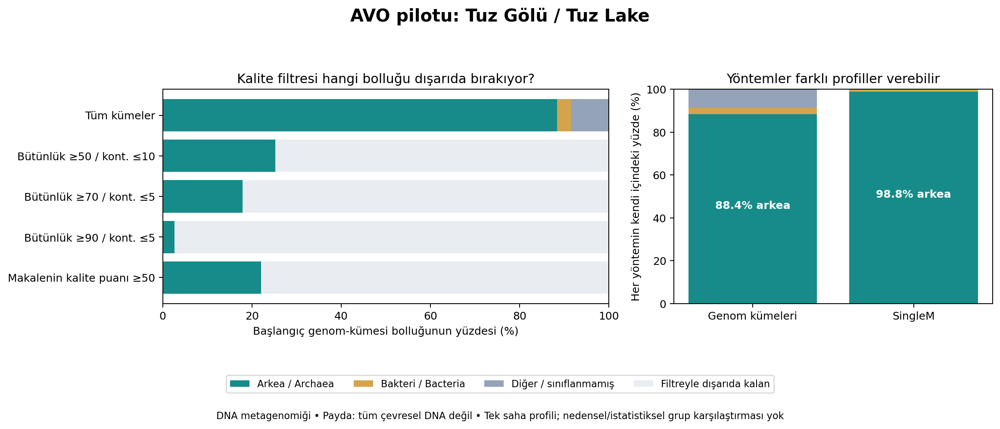

# AVO pilot — Tuz Gölü / Tuz Lake

## Türkçe
Araştırma sorusu: Genom bütünlüğü ve kontaminasyon eşikleri değiştiğinde Tuz Gölü mikrobiyal profilinin hangi özellikleri korunuyor, hangileri değişiyor?

Bu bağımsız, keşif amaçlı yeniden analiz; Mumcu ve ark. (2025), *Exploring extreme environments in Türkiye for novel P450s through metagenomic analysis*, PLOS ONE, DOI: https://doi.org/10.1371/journal.pone.0330523 çalışmasının işlenmiş ek tablolarını kullanır. Kaynak tablolar yazarlarına aittir; makale CC BY kapsamında yayımlanmıştır. Bu pilot resmî bir AVO sonucu veya makaledeki analizin hatalı olduğuna dair bir iddia değildir.

### Bulgular
| Bütünlük / kontaminasyon eşiği (%) | Başlangıç bolluğundan kalan (%) | Kalan bölümde arkea (%) |
|---|---:|---:|
| Ek filtre yok | 100.00 | 88.38 |
| ≥50 / ≤10 | 25.26 | 99.88 |
| ≥70 / ≤5 | 17.91 | 99.88 |
| ≥90 / ≤5 | 2.64 | 99.62 |
| Makale puanı: bütünlük − 3×kontaminasyon ≥50 | 22.07 | 99.88 |

Sıkı eşik profili daraltır: başlangıçtaki bin bolluğunun %97.36'sı dışarıda kalır. Arkea yüzdesinin artması biyolojik bir artış değildir; seçilen alt kümenin yeniden yüzdeye çevrilmesidir. Eşikler keşif amaçlıdır, resmî MIMAG kalite sınıfları değildir.

Kaynakların iki profil yaklaşımı arkeaların baskınlığını destekler: bin tabanlı profil %88.38, SingleM %98.77 arkea. Yöntemlerin paydaları farklıdır; oranlar aynı ölçümün doğrudan tekrarı gibi yorumlanamaz. Alt takson profilleri ve sınıflandırılamayan pay farklıdır. Bin profili filum düzeyinde %40.10 atanmamış kayıt içerir; domain düzeyindeki sınıflandırılamayan pay %8.55'tir.

### Yöntem ve doğrulama
- S1 (`s004.xlsx`): 1135 temsilci binin bolluk tablosu; S5 (`s008.xlsx`): kalite/taksonomi; S3 (`s006.xlsx`): SingleM profil tablosu.
- Bin_ID tekil eşleştirmesi: 1135/1135; kalite tablosundaki üç ek kayıt bolluk tablosunda yoktur.
- Başlangıç Tuz Gölü bin bolluk toplamı %100; her eşikte kalan ve dışlanan pay başlangıç paydasında raporlanır.
- `Unclassified Archaea` ve `Unclassified Bacteria`, belirtilen domain altında tutulur. Daha alt takson ataması uydurulmaz.
- Makalenin kalite puanından geçen 171 bin, kaynak HQ tablosundaki 171 kimlikle birebir eşleşir.
- Betik tekil kimlikleri, eksiksiz eşleşmeyi, toplamları ve filum toplamlarını assertion ile kontrol eder. SHA256 dosya özetleri `results/provenance.json` içindedir.

### Sınırlar ve sonraki adım
Bu DNA shotgun metagenomik verisidir; RNA-seq, ekspresyon veya doğrudan viral profil analizi değildir. Yüzdelerin paydası bütün çevresel DNA ya da hücre sayısı değil, elde edilen temsilci binlerin bolluğudur. Çok küçük pozitif eşleşme gerçek biyolojik varlığı kanıtlamaz. CSV'deki ≥%0.1 sayımı yalnızca keşif amaçlı görüntüleme eşiğidir, doğrulanmış tespit limiti değildir.

İşlenmiş tabloda saha başına tek profil bulunduğundan bağımsız tekrarlı grup testi veya nedensel çevre etkisi çıkarımı yapılmaz. Örnek tipi/tarihi ve yöntem farkları saha karşılaştırmalarında korunmalıdır. Bir sonraki adım, aynı hesabı diğer beş sahaya uygulamak; haritada her profilin yanında dışlanan bolluğu, sınıflandırılamayan payı, kaynak ve yöntem bilgisini göstermektir. Yenilik/yayınlanabilirlik henüz değerlendirilmemiştir.

## English
Question: Which features of the Tuz Lake microbial profile persist when genome completeness and contamination thresholds change?

This exploratory reanalysis uses processed supplementary tables from Mumcu et al. (2025), DOI above. Original tables belong to their authors; the article is published under CC BY. It is not an official AVO finding or a claim of error in the source study.

Without additional filtering, the bin-derived domain profile is 88.38% Archaea, 3.07% Bacteria and 8.55% domain-unclassified. Completeness ≥50/contamination ≤10 retains 25.26% of initial bin abundance; ≥70/≤5 retains 17.91%; ≥90/≤5 retains 2.64%. The paper's completeness −3×contamination ≥50 score retains 22.07%. Archaeal fractions within the respective filtered subsets are 99.88%, 99.88%, 99.62% and 99.88%. These changes reflect filtering and renormalization, not biological growth. These exploratory thresholds are not formal MIMAG classes.

SingleM reports 98.77% Archaea using its own denominator. Both approaches support archaeal dominance, but estimates differ and are not interchangeable. Bin-derived abundance has 40.10% unassigned at phylum level, distinct from the 8.55% unclassified at domain level.

All 1135 abundance IDs uniquely match the quality table; three quality-table IDs are absent from the abundance universe. The score-selected 171 IDs exactly match the source HQ sheet. Assertions check uniqueness, matching, sums and phylum aggregation. Source checksums are recorded in `results/provenance.json`.

This is DNA shotgun metagenomics, not RNA-seq, expression analysis or viral profiling. The bin-abundance denominator is not all environmental DNA or all cells. Tiny positive mapping does not establish biological presence; the ≥0.1% count is an exploratory display threshold, not a validated detection limit. One processed profile per site does not support replicated group significance testing or causal environmental conclusions. Site sample type/date differences must be retained. Extend to the remaining five sites and show excluded abundance, taxonomic uncertainty and provenance alongside interactive profiles. Novelty and publication suitability remain unassessed.

## Run / Çalıştır
Python with pandas, numpy, matplotlib and openpyxl:

```bash
python -m pip install pandas numpy matplotlib openpyxl
python inspect_data.py
python analyze.py
```

`inspect_data.py` downloads the three original XLSX inputs into `data/`. The complete archive `AVO_Tuz_Golu_Pilot.zip` includes `data/` and `results/` with source tables, summary tables, joined data, provenance and figure. Running the two scripts regenerates these directories. No FASTQ download is needed for this processed-table pilot. Original reads were not reprocessed.

Source URLs:
- https://journals.plos.org/plosone/article/file?id=10.1371/journal.pone.0330523.s004&type=supplementary
- https://journals.plos.org/plosone/article/file?id=10.1371/journal.pone.0330523.s006&type=supplementary
- https://journals.plos.org/plosone/article/file?id=10.1371/journal.pone.0330523.s008&type=supplementary

## Figure / Görsel



[Complete analysis archive / Tam analiz paketi](AVO_Tuz_Golu_Pilot.zip)
